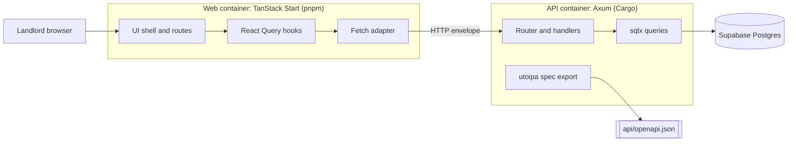

## Context

The repository is two deployable halves plus two package ecosystems: an Axum API (`api/`, Cargo) and a TanStack Start web app (`web/`, pnpm workspace) that calls it over HTTP and keeps transaction bookkeeping in browser storage. Baseline is build-green: `cargo check` passes, and `pnpm --filter web build` produces client and SSR bundles. There is no test suite and no CI, so behavior is verified by running the system.

Three properties of the current state shape this design:

- `pnpm-lock.yaml` and `api/Cargo.lock` are tracked, so installs are reproducible; the defect is that eight `"latest"` entries in `web/package.json` let a refresh change the tree without a manifest diff.
- `api/openapi.json` is committed and written by `export_openapi()` at startup *before* the database connection, so it can be regenerated without Supabase access.
- The web app's only real consumers of upgraded packages are the UI shell, the query hooks, and the fetch adapter; the API's are the router, the sqlx queries, and the utoipa annotations.

Diagram assumptions (C4-inspired, plain Mermaid, container level only): deployment targets are unchanged, and the diagram shows dependency relationships rather than network placement.

- The HTTP envelope is the only contract between the two containers; no web code reads Postgres and no API code renders UI (Architecture A).
- `api/openapi.json` is a committed artifact consumed by the hand-maintained client, which is why an upgrade that perturbs it needs review rather than a blind commit.
- Build toolchains (Cargo, pnpm/Vite) sit outside both containers; they change here, while runtime boundaries do not.
- Transactions stay in browser storage, so the upgrade has no persistence migration to perform.

## Goals / Non-Goals

**Goals:**

- Bring every direct dependency to its current release except TypeScript 7, with each ecosystem's failures isolated to the step that caused them.
- Replace dist-tag declarations with explicit ranges so the next refresh is a reviewable diff.
- Remove dependencies that no file references.
- Preserve the HTTP contract, the UI, and the database schema, with evidence captured before the first change.
- Leave a durable policy record for future upgrades.

**Non-Goals:**

- TypeScript 7, any framework or language migration, and the architecture deepening follow-up.
- Adding tests, CI, or an automated guard for the dependency policy.
- Node, pnpm, or Rust toolchain version movement.
- Any behavior change to properties, transactions, or the envelope.

## Decisions

**1. Explicit caret ranges replace dist-tags.** Each of the eight `"latest"` entries becomes `^<resolved-version>`. Carets keep patch/minor refresh available while making the constraint visible; exact pins were rejected because they make routine patches noisy. A dist-tag was rejected because it provides no review surface at all.

**2. Removal follows reference evidence, not intuition.** `autoprefixer` goes because Tailwind 4 prefixes via Lightning CSS and no PostCSS config exists. `reqwest` and `tokio-test` go because nothing in `api/src`, `api/tests`, or `api/build.rs` references them. The alternative — keep them until tests exist — leaves two unused dev-dependencies and a stale `reqwest 0.12` constraint to maintain.

**3. Rust upgrades are a gated sequence, not one bump.** Lockfile refresh first, then sqlx alone, then the utoipa pair, then tower-http. sqlx changes the migration and query surface, utoipa changes the emitted spec, and tower-http changes layer construction; one combined commit would hide which of the three broke a build. The utoipa pair cannot be separated because `utoipa-swagger-ui` depends on `utoipa 6`.

**4. The OpenAPI acceptance test is semantic.** Regenerate, then compare paths and schema shape. Whitespace, key order, and description churn are acceptable; an added or removed path, a changed property, required flag, or type is a stop. A change in the emitted OpenAPI *version* is also a stop, because it redefines what the client generated against the document may assume.

**5. Verification is a baseline capture plus four checks.** Screenshots of five states at two widths, `cargo check`, the web build, and an `outdated` snapshot are captured before any edit. Afterwards: cargo check per Rust step, web build, a live smoke against Supabase (properties create/list/delete and the transaction UI), a parity audit of the same five states via the `impeccable` and `ui-taste` audit playbooks, and the OpenAPI comparison. A test suite would be the stronger answer but is out of scope; the manual gate is the honest ceiling for this change.

**6. TypeScript stays at 6.0.3.** A compiler migration changes the type-checking surface of the whole web app and deserves its own proposal. The `@types/react` 19.3 and `@types/node` 26.6 bumps may still surface new type errors; those are fixed inside this change rather than by pinning types back.

**7. Policy becomes an ADR.** `adr/0001-dependency-version-policy.md` records the range style, the dist-tag ban, the review-per-major rule, and the TypeScript 7 deferral. It is immutable; a later upgrade that changes the rule supersedes it rather than editing it.

## Risks / Trade-offs

- [sqlx 0.9 changes the `Migrator` API or query metadata] -> Gate sqlx in its own commit and revert that commit alone if `cargo check` or the live migration fails.
- [tower-http 0.7 changes layer signatures] -> Isolate in its own commit; the CORS and trace layers are the only consumers.
- [utoipa 6 reformats or re-encodes the spec] -> Semantic comparison, explicit stop on spec-version change, diff committed only when paths and schema are untouched.
- [Radix and TanStack minor bumps alter props] -> The web build is the gate; failures are fixed in the web commit, not worked around with pins.
- [No automated safety net] -> Live smoke and parity audit are mandatory before merge, and the lockfiles plus diff summary are committed as the durable record.
- [Parity audit is subjective] -> Fixed states, fixed widths, and a stated rule that any unexplained difference is a regression to investigate.

## Migration Plan

1. Baseline capture: screenshots, `cargo check`, web build, `outdated` output into `openspec/.cache/upgrade-baseline/`.
2. Cargo commit: `cargo update` inside declared ranges; check.
3. sqlx commit; check.
4. utoipa pair commit; check and regenerate the spec.
5. tower-http commit; check.
6. Web commit: explicit ranges, upgrades, `autoprefixer` removal; build and typecheck.
7. Removals commit: `reqwest` and `tokio-test`; check.
8. Live smoke against Supabase, then parity audit.
9. Merge locally; no database migration and no deployment step, so rollback is reverting the offending commit.

## Open Questions

- None block planning. The emitted OpenAPI version under utoipa 6 is unknown until the upgrade runs, and it is resolved by the stop rule in Decision 4 rather than by assumption.
