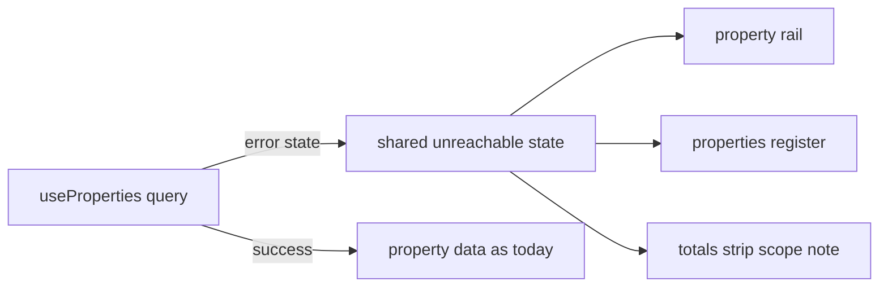

## Context

The web app fetches properties through React Query (`useProperties` → `propertiesApi.getAll`). On rejection today, three surfaces render the silent zero — the property rail, the properties register, the totals strip — indistinguishable from an empty ledger. The 2026-11-22 instrumented incident proved it three times over (stale env, stale server env, API down), each time with the fetch rejecting while the UI printed ₱0.00.

Diagram assumptions (C4-inspired, plain Mermaid): the unreachable state is a render concern of the web container only; no seam elsewhere moves.

- One state component, three mount points — the error flows from the single query the three surfaces already share.
- No API, storage, or ledger semantics change; the book-authority rail keeps its own rules.

## Goals / Non-Goals

**Goals:** one shared unreachable state rendered at the three silent-zero locations, naming problem and recovery, persistent on the page; a fenced scenario the acceptance suite executes against a real browser; the state honest in the passbook voice.

**Non-Goals:** retry redesign, offline mode, stale-data caching, Rust changes, other fetch-fed surfaces (none exist today).

## Decisions

**1. Key the state on the query's error, whatever its class.** Network rejection, a 5xx, or a malformed envelope all mean "the client cannot verify the figures it is asked to print" — the shared state fires on `useProperties`'s error state, with copy that names the connection ("cannot reach the ledger server") rather than a specific failure mode. This answers the reviewer's breadth question: one state, honest about uncertainty, no per-class taxonomy.

**2. The totals strip suppresses its figures while the state shows.** The scope note's slot carries the state line; the ₱0.00 figures do not render beside it — printing money figures the client knows it cannot verify is the exact lie this change removes. This answers the slot-ambiguity question; the parity baseline records it as an explained difference.

**3. Retries: `retry: 1` on this query only.** One quick retry covers a dev-server restart blip; the state lands within ~1s instead of React Query's default 3-attempt window. No retry-policy redesign — a single query's option, within the non-goal's letter and spirit.

**4. The scenario keys structurally, not on prose.** The shared state carries `data-unreachable="properties"` at all three mount points; the step asserts that marker at each location plus the presence of problem-and-recovery copy, never exact strings — so the implementer's voice is free while the assertion stays deterministic.

**5. The suite drives it with a dead base URL, not a stopped API.** The harness boots the app exactly as today (API up, web up) but for this scenario the page's base URL points at an unbound port — `VITE_API_BASE_URL=http://localhost:9` baked into a scenario-local page load. No harness lifecycle changes; the API keeps serving the other 31 scenarios.

## Risks / Trade-offs

- [The state renders during any real outage, not just dev mistakes] -> That is the point; the copy names recovery, and DESIGN.md records the state as explained for any future parity pass.
- [A second active web-app delta (the redesign change) joins the suite] -> Both deltas ride the effective run; no rule-name collision (it MODIFIES the three existing requirements; this ADDS one); its suite-minus-self child run grows 23 → 24 and any failure there is this change's to fix before either archives.
- [Suppressing strip figures changes a rendered surface] -> The parity note in the proposal covers it; audits never reach the unreachable path (API always up in harness runs).

## Migration Plan

1. Specs zone: this change's delta (committed with the artifacts).
2. Code zone: the shared state component + its three mount points + `retry: 1` on the query; the scenario's feature text needs no harness change.
3. Steps: the unreachable scenario's step definitions (dead base URL, marker assertions at three locations).
4. Full suite green at 32 scenarios; the redesign change's suite-minus-self run green at 24.

## Open Questions

- None blocking. The copy's exact string remains the implementer's within the pinned voice.
