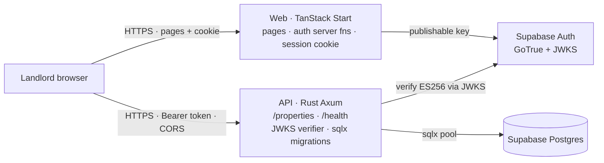
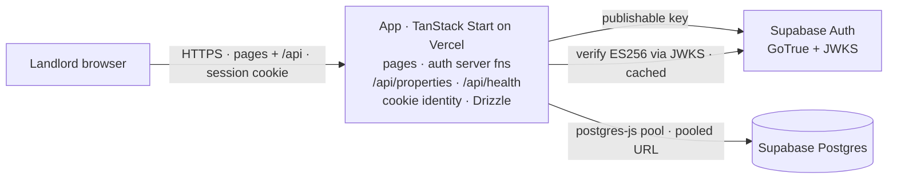

# fullstack-tanstack — Design

## Context

The repository runs two deployable units for one product. The web is TanStack Start 1.169 (Vite, `@supabase/ssr`, React Query) serving every page and the auth server functions; the API is a Rust Axum service (`sqlx`, `jsonwebtoken`, `reqwest`) serving `/properties` and `/health`, verifying ES256 tokens against the project JWKS, and owning the only migration runner. The browser holds a Supabase session cookie for the web **and** reads an access token from it to send `Authorization: Bearer` to a second origin, which the API allows through a CORS list.

`landlord-accounts` (complete, not yet archived) added that identity and ownership model: `properties.owner_id` is `NOT NULL`, owner-scoped RLS is enabled, `anon`/`authenticated` hold no grant, and a foreign row answers 404. Those guarantees must survive this change unchanged.

Constraints that shape everything below:

- The deployment target is Vercel, which runs functions, not a long-lived Axum process with a Postgres pool.
- Supabase Postgres is reached through a pooler; the project's URL is a session-mode pooler on port 5432.
- The acceptance suite is the only automated proof of the wire contract, and it drives both processes today.
- Three queued changes (`server-transactions`, `payment-reminders`, `pointer-affordances`) are written against the Rust API.

## Goals / Non-Goals

**Goals**

- One deployable unit serving pages and the properties routes on one origin.
- The existing HTTP contract preserved: envelope, status codes, validation, ownership.
- Identity from the session cookie, verified with the same ES256/JWKS policy.
- A schema and migration path that survive deleting `api/` without touching data.
- A build the deployment platform runs, with a fail-fast environment contract.

**Non-Goals**

- Production provisioning, DNS, SMTP, CAPTCHA, and the first release.
- Any new product behaviour, route, field, or ledger/reminders work.
- A public API for non-browser clients.
- Rewriting the queued changes.

## Architecture

Lightweight C4: one container view before and after, enough to show what disappears and what moves. Mermaid is used because the project's existing designs use it.

### Container view — before

### Container view — after

Assumptions: Vercel runs the app as Node functions (Fluid compute); the Supabase pooler stays in session mode for the app; migrations run from an operator/CI step, not from a function. Open questions at the end cover what this diagram does not settle.

## Decisions

### 1. HTTP server routes under `/api`, not server functions

`/api/properties` (`GET`, `POST`), `/api/properties/:id` (`DELETE`), and `/api/health` are TanStack **server routes**. Auth stays on the existing server functions.

*Why*: the acceptance suite, the hand-maintained client, and the `properties` spec all speak HTTP with an envelope. Server routes keep that contract and keep the routes curl-able with a cookie jar; server functions would replace it with an RPC protocol and force a client and harness rewrite for no product gain.

*Alternatives*: server functions only (rejected: rewrites the contract and the harness); content negotiation on `/properties` (rejected: fragile and still collides with the page route).

*Consequences*: the JSON surface moves from `/properties` to `/api/properties` because the web already owns `/properties` as a page. Two Rust behaviours become explicit obligations: `DELETE /api/properties` with no id answers the 400 envelope (today a separate handler), and an unmatched `/api/*` answers the JSON envelope rather than the app's HTML not-found.

### 2. Identity from the session cookie, verified with `jose`

The route handler reads the Supabase session cookie, extracts the access token, and verifies it locally: ES256 only, pinned `iss`/`aud`, `exp` with 60 s leeway, UUID `sub`, `role: authenticated`, no `is_anonymous`. Keys come from the project JWKS, cached for ten minutes, one refetch on an unknown `kid`, fail closed with 503.

*Why*: same origin means the browser already sends the cookie. Local verification keeps the per-request cost at zero network hops and preserves every security property. `supabase.auth.getUser()` per request would add a GoTrue round trip to every call and a new outage mode.

*Cookie contract* (part of the work, not an implementation detail): the cookie is `sb-<project-ref>-auth-token`, base64url JSON, chunked as `.0`, `.1`, … when large; the reader assembles chunks, tolerates the legacy unchunked name, and answers 401 — never a crash — on malformed JSON, a missing token, or an unparsable chunk. The Playwright harness's forged-token scenarios become forged-**cookie** scenarios.

*Alternatives*: keep Bearer (rejected: two auth paths, CORS, token in JS); `getUser()` per request (rejected: latency and a new failure mode).

### 3. Refresh at the route boundary, with rotated cookies on the response

When the access token is expired but the refresh token is valid, the route refreshes through the server Supabase client and returns the data with the rotated `Set-Cookie` headers on the same response.

*Why*: the access token is httpOnly; the browser cannot refresh or re-read it. The server already owns the refresh in the document middleware; the route boundary extends the same rule so an XHR does not need a second round trip.

*Alternatives*: a client-side refresh (impossible with httpOnly cookies); middleware-only refresh (leaves a long-lived tab's XHR unrefreshed).

### 4. Drizzle with the existing SQL moved, a frozen baseline, and no `push`

A `db/schema.ts` describes `properties`; `db/migrations` carries a **frozen baseline** that reproduces the currently applied schema, marked as applied in Drizzle's journal, plus any later migration. RLS policies, the `revoke all … from anon, authenticated`, the `auth.users` foreign key, and the backfill `DO` block stay hand-authored SQL inside the migration — `drizzle-kit` cannot model them and would emit drops.

Rules:

- `drizzle-kit generate` writes migrations; `drizzle-kit push` MUST NOT be run against Supabase.
- Migrations run through a dedicated script over the **direct** (non-pooled) connection; the app's runtime connection is pooled and never migrates.
- No migration runs at build time or on a request.
- The baseline is proven by applying it to a scratch database and diffing the catalog against the live schema.

*Why*: the schema history is the only record of the RLS and grant work; re-deriving it from a TypeScript schema would silently drop the security layer. A frozen baseline lets an existing database and a fresh one converge.

*Alternatives*: raw SQL with a hand-rolled runner (viable, rejected by the settled decision); `drizzle-kit push` (rejected: destructive against a live schema with hand-authored SQL).

### 5. `postgres-js` as the driver

*Why*: it exposes `prepare: false`, which the Supabase transaction pooler requires, and it behaves well in short-lived functions. `node-postgres` is equally capable but needs more care with statement names under the pooler.

*Consequence*: one small pool per function instance; `/api/health` costs one round trip per probe.

### 6. CSRF because the credential is ambient

`Secure` + `SameSite=Lax` on the session cookies, and a check on every state-changing `/api` request that `Origin` (or `Sec-Fetch-Site` when `Origin` is absent) is the app's own origin. A mismatch answers 403 with the envelope.

*Why*: a Bearer header cannot be attached by a cross-site form; a cookie can. CORS never protected the server, so removing it is not a security regression only if this check exists.

*Alternatives*: double-submit token (more moving parts for no gain with `SameSite=Lax`); relying on `SameSite` alone (insufficient for older clients and for same-site subdomain attacks).

### 7. Strangler, with the parity matrix as the gate

Order: schema and migrate script → routes beside Rust → switch the web client and the harness → run the full suite → delete `api/` and the generator in the same change.

*Why*: the Rust service is the reference implementation until the suite proves the port. Deleting first would make every regression a debugging exercise with no oracle.

*Gate*: the proposal's parity matrix — envelope/status for five cases, four validation cases, five ownership cases, eight auth cases, the closed Data API, and the ported Rust unit tests — must pass before deletion.

### 8. Health stays a readiness answer

`/api/health` returns 200 when the database answers and 503 when it does not, with the envelope. It is **not** a liveness probe; the harness boot-waits on `success === true`. If the platform needs a liveness path, the deployment change adds a database-free route rather than overloading this one.

### 9. Deployable, not deployed

Add the Nitro Vite plugin and a Vercel target so `pnpm build` emits a runnable server, document the environment contract, and prove it by starting the built server and hitting a page and a route. Production provisioning is out of scope.

## Risks / Trade-offs

- **Parity regression in validation or status** → the matrix in Decision 7, plus the ported Rust unit tests, gate the deletion.
- **Drizzle drift, or a stray `push` destroying RLS** → baseline diff against the live catalog; `push` banned; migrations reviewed as SQL.
- **Serverless pooling and cold start** → `prepare: false`, a small pool, and the JWKS cache pre-warmed by the first authenticated request; measured, not assumed, during the cutover.
- **Cookie parse bugs answering 401** → the cookie contract above is unit-tested (chunk assembly, malformed input) before the routes ship.
- **`localhost` vs `127.0.0.1` cookie scope** → the harness already probes both families; the accepted origins are pinned and the suite runs on one of them.
- **Incomplete CSRF coverage on one verb** → the check lives in one helper applied by every mutating route, with a test per verb.
- **`/api/health` mistaken for liveness** → documented here; a separate liveness route is deferred to the deployment change.
- **Losing the Rust tests** → porting them is a task, not an extra.

## Migration Plan

1. **Precondition** — archive `landlord-accounts` so its `web-app` and `authentication` deltas are in `openspec/specs/`.
2. **Schema** — add Drizzle, the frozen baseline, and the migrate script; prove the baseline against a scratch database; no runtime change yet.
   The development database had drifted from the migrations (the table predated them, so `create table if not exists` was a no-op and the types, nullability and checks never landed). A one-time repair, `web/db/repair/2026-11-26-align-properties.sql`, brings it to the baseline; the catalog diff is then empty and a fresh database matches development.
3. **Routes** — implement `/api/health`, then `/api/properties` (list, create, delete, delete-without-id, unknown-path), with the cookie verifier and the CSRF helper. Rust still serves the web.
4. **Ported tests** — validation and the auth decision table in Node; the ownership matrix against the real database.
5. **Switch** — the client, the harness (one process, cookie steps, migrate step), and the hostile probes (a second app instance with a sabotaged environment).
6. **Prove** — the full acceptance suite, change-scoped, green.
7. **Delete** — `api/`, `openapi.json`, the generator, CORS config, and the Cargo scripts; update the specs, `config.yaml`, the glossary, and both READMEs.
8. **Rollback** — steps 1–5 leave the Rust service and the database untouched, so reverting the client switch restores the old path. Once step 7 lands, rollback is a revert of the commit; no data was migrated, so nothing is lost.

## Open Questions

- Does the installed TanStack Start build expose server routes with a `server.handlers` shape, or does this version still require `createServerFileRoute`? Confirm before task 3 rather than guessing.
- The exact mechanism to seed Drizzle's journal with the frozen baseline (a checked-in journal entry versus `drizzle-kit migrate --fake`). Proposed: a checked-in journal entry, verified against a scratch database.
- Does development keep the two-process `pnpm dev` (web on 3001, Rust on 3000) until step 7, or move to one process on 3001 immediately? Proposed: one process from step 3, with the Rust API left for the harness's reference until step 7.
- `postgres-js` versus `node-postgres` — settled above as `postgres-js`; revisit only if the pooler's session mode proves incompatible.
- ADR-0007 is in force and its cache rule is justified by an edge cache this design removes. The adr step records a superseding decision that restates the surviving rules; this design does not modify it.
