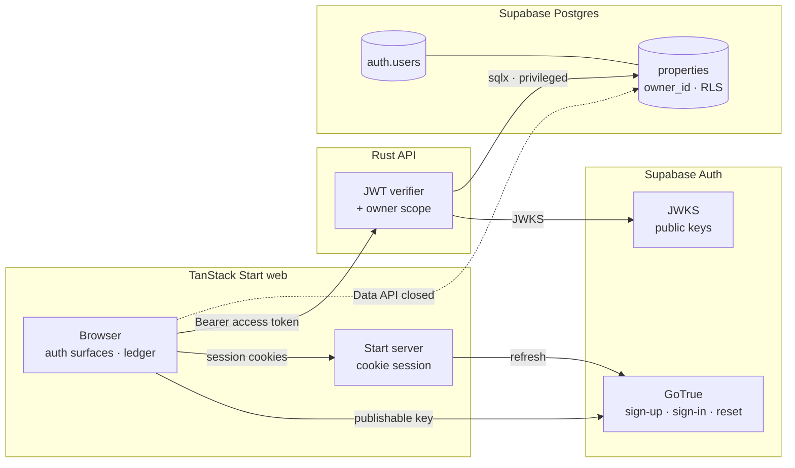

## Context

The app has no auth: the API's bearer check only inspects a prefix, the extractor always rejects, neither is wired, `properties` has no owner, and the browser's ledger is one key shared by anyone on the device. The API is the only data path (a privileged Supabase Postgres connection), so RLS cannot be the primary control. Supabase Auth is already adjacent to the database and provides the identity features; the guidance below is taken from the current Supabase docs (JWTs/JWKS, `@supabase/ssr`, password flows, RLS, and the package-selection guide).

- The browser talks to Supabase Auth only for identity; it never reads data from the Data API.
- The Start server owns the cookie session lifecycle; the Rust API verifies the access token independently.
- The API is the only writer; RLS exists for the direct path that is closed.

## Goals / Non-Goals

**Goals:** per-landlord identity and isolation; JWKS verification without the Auth server in the hot path; cookie sessions with refresh rotation; a per-account local ledger with a safe legacy import; a suite that runs as real owners; a closed direct Data API path.

**Non-Goals:** custom credential handling; third-party IdP; teams/sharing; OAuth/passkeys/MFA; a data path through the Data API; a token-hiding proxy; server-side ledger; account deletion/switch UI; cross-tab sign-out; legacy-ledger encryption.

## Decisions

**1. Identity flows.** Supabase Auth email/password. Sign-up sends a confirmation email; the account cannot sign in before confirmation and the sign-in error offers a resend. Sign-in starts a cookie session. Sign-out ends it. Reset requests are generic, and the recovery link updates the password. The web uses `@supabase/ssr` with PKCE and cookie storage; the Start server refreshes the session and writes rotated cookies; the browser client reads the session for the API token. Public routes: sign-in, sign-up, confirm, reset, new-password.

**2. Rust verification.** The API extracts the Bearer token and verifies it against `https://<project>.supabase.co/auth/v1/.well-known/jwks.json`:

- `alg` is ES256 only; `none` and HS-family tokens are rejected.
- `iss` and `aud` are pinned to the project; `exp` allows a small leeway.
- `sub` must be present; `role` must be `authenticated`; an `is_anonymous` claim is rejected (Supabase anonymous users carry the authenticated role, so the role check alone is insufficient).
- The key set is cached for ten minutes, refetched once when an unknown `kid` arrives, and never cached longer. If no key verifies and the set cannot be fetched, the API fails closed with 503 and the envelope; it never accepts the token.
- The verifier is injectable so API tests use a local JWKS fixture and CI is not network-dependent.

The existing `require_auth` middleware and the always-fails extractor are removed; one extractor returns `Identity { sub, email, role }` or the 401 envelope.

**3. Ownership.** `properties.owner_id` references `auth.users(id)` with `on delete cascade`, is indexed, and becomes `NOT NULL`. Every repository call takes `Identity`: list filters by `sub`, create writes it, delete matches `id` and owner together and returns 404 for a non-owned or unknown id. The client never supplies an owner. The API exposes list, create, and delete only; a future update adopts the same predicate.

**4. Direct Data API closure and RLS.** The publishable key makes the Data API reachable, so the project disables the Data API and the `anon`/`authenticated` grants on `properties` are revoked. RLS is enabled with `authenticated` policies on `owner_id = auth.uid()` (select/insert/update/delete, `with check` on writes) as defense if that path is re-enabled. The API's privileged role bypasses RLS, so app-level scoping is the primary control. The direct path is tested (a REST request with a landlord token is refused); the RLS policies themselves are not exercised while the Data API is off, and a role-based policy test is a named follow-up if it is re-enabled.

**5. Bootstrap and migration.** A SQL migration cannot create an `auth.users` row. The sequence is:

1. An idempotent seed step uses the Auth admin API with an operator-held service key to create or find the **Bootstrap owner**; the seed runs before the migration in environments with existing rows.
2. A migration adds `owner_id` nullable and its index.
3. An operator backfill sets the existing rows' owner by lookup; it aborts when the owner is absent.
4. A migration sets `NOT NULL`, adds RLS, revokes the client grants, and records the Data API closure.

Production starts with no property rows, so steps 1 and 3 are no-ops there and the first real sign-up owns its own data. Local and acceptance environments seed the owner. The migration is one-way and fails loudly rather than inventing an owner.

**6. The local ledger.** The ledger key becomes `landlord-transactions:<user-id>`. The pre-auth `landlord-transactions` key is moved to a legacy namespace and is never attributed to whoever signs in; the signed-in account sees an explicit import offer, the entries stay hidden until confirmed, and another account never receives them. On sign-out the visible ledger, the React Query cache, the zustand property store, and the filter store are cleared so no previous owner's data flashes. Cross-tab sign-out is not guaranteed beyond the next request or navigation.

**7. Web client and guards.** A `beforeLoad` guard on the shell reads the server-side session and redirects unauthenticated visitors to sign-in with a return target. The target is validated as a same-origin relative path beginning with a single `/`; absolute URLs, `//`, a scheme, or a backslash fall back to the default page. The guard, the confirm route, and the new-password route all use the same validator. The header shows the signed-in email and a sign-out control.

**8. The authenticated API client.** One wrapper attaches the access token, and on 401 refreshes the session once and retries. A second 401 or a failed refresh signs out and redirects. A 503 from the API (key-set outage) maps to the existing unreachable state, never to a sign-out or an empty record.

**9. The test identity.** The acceptance environment seeds two owners (A and B) through the admin API and holds a service key so the harness can create, confirm, and remove disposable identities. Confirmation stays enabled because the single project also serves production; CAPTCHA stays off so the browser sign-up path is drivable. The harness signs in A once per run and reuses the storage state across scenario contexts; the suite-minus-self child signs in on its own ports. B exists for isolation scenarios. Sign-up, sign-out, and password-reset scenarios use disposable identities created and removed through the admin API. Every `landlord-transactions:*` key is cleared between scenarios. The suite's Postgres is the Supabase Postgres, so `auth.users` exists; this is verified before the harness work. The confirmation contract is asserted through the auth API and the configured email path; the email itself is a production/deploy check, not a per-run browser test.

**10. Configuration and secrets.** The web carries `VITE_SUPABASE_URL` and the publishable key only. The API carries the issuer, JWKS location, and audience, and refuses to start without them. The service/secret key belongs only to the seed and the test harness, never to the web or the API runtime. Anonymous sign-ins are disabled. Production sign-up uses Supabase's rate limits and a CAPTCHA provider; confirmation and reset use a configured SMTP provider. These are deploy prerequisites with an owner named before release.

**11. Deploy unit.** Seed, migrations, API, and web ship together. The API rejects unauthenticated traffic as soon as it deploys, so a partial deploy breaks the app; the migration is one-way. The rollback is the whole unit, not one tier.

## Risks / Trade-offs

- **Acceptance DB auth** — the highest-uncertainty assumption: `auth.users` and GoTrue must be reachable from the suite's environment.
- **Token exposure** — the refresh token moves to cookies but remains browser-readable; the access token is JS-visible for Bearer. XSS can take both until the token-hiding proxy lands.
- **Deploy coordination** — a required token plus a NOT NULL backfill plus a seeded identity has no partial rollback.
- **Production email and abuse** — SMTP, CAPTCHA, and rate limits have no owner yet; sign-up is not production-ready without them.
- **RLS is unverified defense** — the direct path is closed and tested; the policies wait for a role test if it is re-enabled.
- **Legacy ledger** — preserved and explicitly imported, not encrypted; a shared browser is in the threat model.
- **Pending reminders** — its tables must gain `owner_id`; applying it first collides with the migration chain.

## Migration Plan

1. Seed the bootstrap owner (admin API) in environments with existing rows.
2. Add `owner_id` nullable + index; backfill by lookup with an abort; set `NOT NULL`.
3. Add RLS policies; revoke client grants; disable the Data API.
4. Ship the API verifier and owner scoping.
5. Ship the web auth surfaces, guards, client, and account-scoped ledger.
6. Seed the test owners; update the harness; add the auth/isolation scenarios; run the suite.

## Open Questions

- Which SMTP provider and CAPTCHA provider are chosen, and who owns the production configuration.
- Whether the production first owner is created by the seed or by the first sign-up (with no existing rows, either works; the seed is recommended).

Resolved: confirmation stays enabled in the single project, so the harness holds a service key for disposable identities instead of the environment disabling confirmation.
