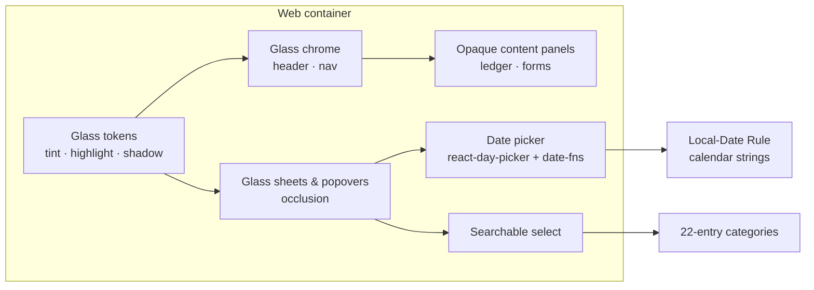

## Context

The web app carries the Bank Passbook world: paper ground, hairlines, mono tabular numerics, and honesty instruments that three critique rounds hardened. The user has pinned a replacement world — Liquid Glass — with an explicit honesty rail: glass only where it carries a job, content surfaces opaque under text, fallbacks everywhere. The reference implementation for the two new controls lives in `~/Projects/Personal/agent-lender`: a `react-day-picker` v9 calendar inside a Radix Popover with a typed, validated input, and a Radix Select with a searchable variant.

Diagram assumptions (C4-inspired, plain Mermaid): one new primitive layer inside the web container; no runtime seam elsewhere moves.

- Glass sits only above content; the panels beneath text are opaque by construction.
- The picker and select are the only new primitives; both wrap existing Radix seams.
- The tokens are one layer; every glass surface and fallback reads them.

## Goals / Non-Goals

**Goals:** replace the passbook world with the glass material under the honest rails; adopt the agent-lender picker/select patterns with `react-icons`; keep every honesty behavior and the suite gate intact.

**Non-Goals:** Rust changes; behavior beyond the component swaps; a second icon library; a theme/skin switch; routing changes.

## Decisions

**1. Glass tokens, one layer, measured.** Four token groups: `--glass-tint` (translucent surface), `--glass-highlight` (layered border), `--glass-shadow` (elevation stack), `--glass-blur`/`--glass-saturate` (the budget: blur ≤ 24px, saturate ≤ 160%). Every glass surface reads these; no component invents a blur. Measured rendered pairs are recorded beside the tokens in DESIGN.md.

**2. Legibility model: two text classes, two measurement methods.** Content text (body, numerals, ledger figures) sits on opaque panels — measured text-vs-panel. Chrome text (nav labels, header actions) sits on glass — measured against the worst-case sampled composite behind the glass (sampled from rendered pixels over the busiest route content, with the documented composite recorded). Non-text marks (borders, highlights, icons) hold 3:1 against their surface.

**3. The blur boundary is structural.** No glass element may contain a scrolling descendant: glass chrome is `position: fixed` or `sticky` with `overflow: visible`; any scrolling subtree inside a glass sheet or popover renders on an opaque panel. Enforced by a lint-style check in the craft pass and by the glass-surfaces scenario.

**4. Fallbacks are one cascade.** `prefers-reduced-transparency: reduce` → opaque tint; `@supports not (backdrop-filter: blur(1px))` → opaque tint + solid border; `forced-colors: active` → system colors, borders preserved; `prefers-reduced-motion: reduce` → travel gated, opacity cross-fades stay. The combined forced-colors + no-backdrop-filter case renders an opaque panel with a solid system border. One cascade, four conditions, one Outline.

**5. The picker is the agent-lender pattern, re-written for this stack.** `ui/calendar.tsx` wraps `react-day-picker` v9 (range mode supported for the filter pair) with `react-icons` chevrons; `ui/date-picker.tsx` wraps it in a Radix Popover with a typed input parsed by the Local-Date Rule's calendar-string helpers (`format.ts` already owns `localDateString`/`localMonthKey`; a `parseCalendarDate` companion lands there, not in a second date module). `date-fns` is used only for formatting/parse helpers where `Intl` cannot do the job.

**6. The searchable select is a variant, not a replacement.** `ui/searchable-select.tsx` is a popover combobox: a Radix Popover holding a filter input and a listbox (`aria-activedescendant`, arrows/Home/End/Enter/Escape, a visible no-match message) — the agent-lender pattern. Radix Select was the first sketch, but its roving-focus listbox owns the keyboard and cannot host a filter input without stranding keyboard users, so it cannot meet the spec's "fully keyboard-operable". The transaction category select uses the combobox; the property filter keeps `ui/select`.

**7. Icon migration is mechanical and final.** `react-icons` everywhere; `ui/select.tsx` and `ui/dialog.tsx` migrate off `@radix-ui/react-icons`; the package retires (dependency-maintenance's unreferenced rule). One stroke family per surface.

**8. Motion and type follow the loaded skill floors.** Popover enter 250ms ease-out, exit 150ms, scale 0.96 from the trigger origin; month change ≤150ms cross-fade; highlights ≤150ms; reduced-motion gates travel. Tabular numerals on figures and calendar days; inputs `text-base sm:text-sm`.

## Risks / Trade-offs

- [Composited blur on fixed chrome over long sessions] -> Blur confined to small fixed surfaces; measured at the craft pass; no blur on scrolling content by construction.
- [The four-condition Outline is the suite's first] -> Steps implemented once with a condition-to-emulation switch; the combined case included.
- [Range-mode keyboard behavior is the least-standard interaction] -> The keyboard scenario covers arrows/PageUp/Down/Home/End/Enter; Escape restores the trigger.
- [World replacement resets visual baselines] -> Intentional: the parity baseline restarts against the glass world; the passbook captures stay as history.
- [Passbook-era queued fronts (reading column, Unknown-Property, snackbar re-pin, No-matches)] -> They survive as behavior constraints where still relevant; the new world's layout re-lands the ledger, and the queued list rides the tasks' carry-forward section.

## Migration Plan

1. Tokens + glass surfaces on the shell/nav (code zone, committed); fallbacks in the same commit.
2. `ui/calendar.tsx` + `ui/date-picker.tsx`; the transaction form swaps its date input; the filter pair becomes one range picker.
3. `ui/searchable-select.tsx`; the category select swaps; icon migration completes; `@radix-ui/react-icons` retires.
4. The four route chromes re-skinned; the honesty instruments verified in the new world (strip claims, rail caveat, unreachable state, undo, exports).
5. Craft pass (better-ui/colors/layout/typography values), screenshots at 1440/390, the detector, the finish review; DESIGN.md replaced at finish.

## Open Questions

- None blocking. The exact tint alphas are the craft pass's measured outcome, not a plan input.
