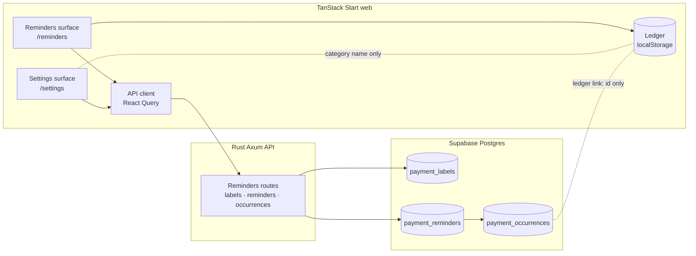

## Context

The app already has two data homes: properties live in Supabase behind the Rust Axum API, while the transaction ledger lives in each browser's localStorage. Payment reminders are financial history the operator wants durable, so the user chose the API-backed path (ADR-0005). The shell is the Liquid Glass world (ADR-0004); the ledger's dates follow the **Local-Date Rule**.

This change adds the reminders domain (labels, reminders, occurrences), a Reminders surface, a Settings surface that debuts with the label manager, and the mark-paid handshake between the server record and the local ledger. It also extends property deletion to cascade (ADR-0006).

Assumptions: one operator, no auth (the API's existing posture), and the reminders endpoints share the properties API's host and CORS reach.

- The API owns labels, reminders, and materialized **Occurrence** rows; the browser owns the ledger.
- Two cross-store references are names/ids, not foreign keys: the label's category name and the occurrence's **Ledger link**.
- The web is the only place the two stores meet; the server never reads the ledger.
- The gear sits in the existing header glass chrome, so no `glass-surfaces` delta is needed.

## Goals / Non-Goals

**Goals:** durable per-property reminders whose per-period amounts and paid history are editable and auditable; a managed label picklist; a mark-paid flow that can record the linked ledger expense without silently double-counting; honest missing-link and unreachable states; the property cascade with a warned confirmation.

**Non-Goals:** auth/multi-user, notifications, income reminders, moving the ledger server-side, offline sync, multi-currency, attachments, general tagging, Settings beyond labels, Overview badges/totals, un-pay.

## Decisions

**1. Occurrences are materialized rows (ADR-0005), generated in Rust.** A reminder's occurrences are stored, not computed on read, so each date has a stable id for amount edits, paid/skipped status, and the ledger link.

Generation rule:

- The first occurrence is the first date on or after the start date whose day matches the **Due day**, clamped to the month's last day. Monthly advances one month, quarterly three months from the start month, annual twelve months in the start month, one-off only the start date.
- Generation stops at the end date when present. Otherwise it runs through the **Occurrence horizon**: `min(end date, today + 10 years)`. A read re-runs generation when the horizon has advanced, inserting only missing due dates, so the horizon bounds how far ahead rows exist rather than how long the reminder lives.
- Every occurrence starts at the reminder's default expected amount. `unique (reminder_id, due_date)` prevents duplicates.

**2. Editing a reminder preserves paid history.** A rule change (frequency, due day, start, end, default amount) keeps every paid and skipped occurrence, deletes unpaid occurrences due on or after the request's `today` (the web sends its local date; the API defaults to the server's date), and regenerates the schedule through the horizon. Past unpaid (overdue) rows stay as they were. A paid occurrence's amount and date are correctable; paid is not reverted to pending. Skipped may be returned to pending (a decision, not a money reversal).

**3. Data model.** One migration adds:

- `payment_labels`: `id uuid pk`, `name text not null` with a `lower(name)` unique index, `category text null`, `created_at`, `updated_at`.
- `payment_reminders`: `id uuid pk`, `property_id uuid not null references properties(id) on delete cascade`, `label_id uuid not null references payment_labels(id) on delete restrict`, `frequency text` checked to `monthly|quarterly|annual|one_off`, `start_date date`, `end_date date null` with `end_date >= start_date`, `due_day int` 1–31, `default_amount numeric(12,2) >= 0`, `notes text null`, timestamps.
- `payment_occurrences`: `id uuid pk`, `reminder_id uuid not null references payment_reminders(id) on delete cascade`, `due_date date`, `expected_amount numeric(12,2) >= 0`, `status text` checked to `pending|paid|skipped`, `paid_date date null`, `paid_amount numeric(12,2) null`, `linked_transaction_id text null`, timestamps, `unique (reminder_id, due_date)`.
- Indexes: `payment_reminders(property_id)`, `payment_occurrences(reminder_id, due_date)`, `payment_labels(lower(name))`.

The category and the ledger link are stored names/ids, deliberately without foreign keys: the category list is a web constant and the ledger is not in Postgres.

**4. API surface (envelope `{ success, message, data? }`, camelCase).**

- `GET /payment-labels` (with `usageCount`), `POST /payment-labels`, `PATCH /payment-labels/{id}`, `DELETE /payment-labels/{id}` → 409 when referenced by any reminder.
- `GET /payment-reminders` (summary: property/label names, rule, next pending due, horizon end), `POST /payment-reminders`, `GET /payment-reminders/{id}` (with occurrences), `PATCH /payment-reminders/{id}`, `DELETE /payment-reminders/{id}`.
- `PATCH /payment-occurrences/{id}` for expected amount, status transition, paid amount/date, and ledger link.
- Status codes: 201 create, 200 read/update, 400 validation, 404 missing, 409 label in use. Validation names the offending field.
- `api/openapi.json` gains the paths and schemas; `scripts/generate-api-client.ts`'s `requiredPaths` grows; the hand-maintained `web/src/lib/api-client.ts` gains the methods and `web/src/lib/domain.ts` the types.

**5. The mark-paid handshake is ordered and its failures are named.** The occurrence is marked paid only after the API confirms. The linked expense is a second step: the web writes the ledger transaction locally, then PATCHes the occurrence's ledger link. If the ledger write fails, the occurrence stays paid and unlinked; if the link PATCH fails, the ledger row exists and the occurrence is unlinked. Both states are shown with a retry, never silently reconciled. The prompt prefills property from the reminder, category from the label's mapping, amount and date from the payment, and description from the label name, all editable.

**6. The last-payment seed is a local-ledger convenience.** With a mapped category, the form reads expense transactions for the same property and category, prefers the latest whose description contains the label name, falls back to the latest same-property/category payment, and offers its amount/date/description. Without a mapped category, no seed is offered. This is not a server lookup.

**7. Honest readings.** The history derives **Overdue** client-side from the local date (never a server flag). A paid occurrence whose ledger id is absent reads "not in this browser's ledger" — the truth after deletion or cleared storage — and its paid status is unchanged. The Reminders and Settings surfaces reuse the named-unreachable treatment for a failed API, never an empty list or ₱0.00.

**8. UI and world.** `/reminders` becomes a fourth section tab; Settings is a gear in the existing header glass chrome. Reminders render as ruled rows and a history table on opaque paper, figures in tabular mono, the Local-Date Rule for every date. The reminder form and mark-paid prompt are dialogs; the label manager is a ruled list. Nothing is added to Overview, totals, or the ledger except the optional linked expense.

**9. Property deletion cascades (ADR-0006).** The API removes the property, its reminders, and their occurrences in one transaction; the web confirmation names the reminders and history before the act. The `properties` delta owns the cascade; the `web-app` delta owns the copy.

## Risks / Trade-offs

- **Two stores, two truths.** Occurrence paid amounts live in Postgres while the ledger is the browser's, so the two never reconcile by design; the UI must not imply they do.
- **One operator, many browsers.** Rows are shared and the ledger is not, so seeds and link states differ per device.
- **Cascade data loss.** A property or reminder deletion erases paid history irreversibly; both confirmations must say so.
- **No un-pay.** A wrong paid amount is corrected by editing, not by reverting; the operator cannot clear a mistaken paid state.
- **Horizon and timezone.** Regeneration trusts the client's `today`; a wrong device date can change which unpaid rows are replaced.
- **Global label teardown.** Labels are global and refuse deletion while referenced; acceptance teardown must delete reminders before labels, and a mid-run failure can strand a label.
- **Exposure.** Financial history joins an unauthenticated API; the reach is unchanged but the blast radius grows.

## Migration Plan

1. Migration + Rust models, validation, routes, OpenAPI export.
2. Generated client update, domain types, React Query hooks.
3. Settings surface + label CRUD; the reminder form and list.
4. Occurrence history, mark-paid + ledger link, seed, overdue and missing-link readings.
5. Property cascade + confirmation, nav tab + gear, unreachable states.
6. Acceptance scenarios (API and browser) with probe cleanup; craft pass; suite green.

## Open Questions

None blocking. The occurrence horizon is ten years from the current date, a design choice this document records; the exact amount formatting stays the ledger's `formatMoney`.
