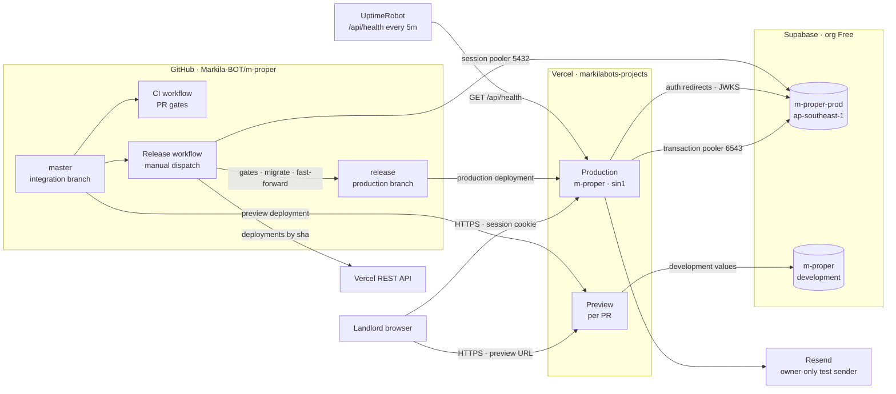
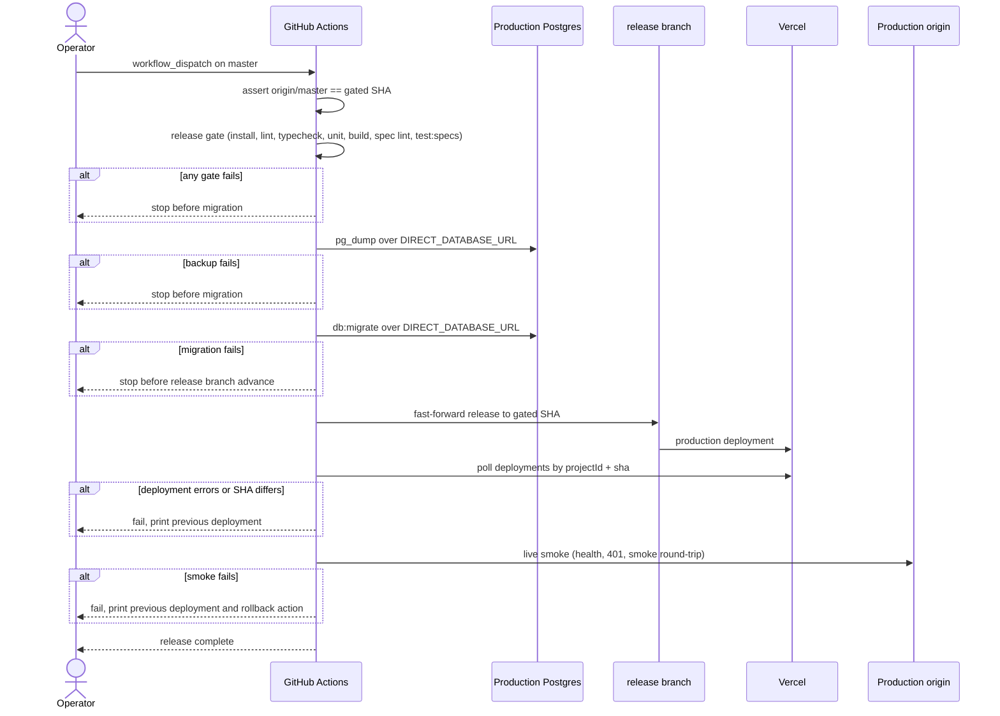

# production-deployment — Design

## Context

The product is one TanStack Start app: pages, auth server functions, and `/api/properties` and `/api/health` on one origin. Drizzle owns the schema and migrations over Supabase Postgres; the Supabase session cookie is the identity. `fullstack-tanstack` is complete but unarchived. The current Supabase project is the development project, and no Vercel project exists for `m-proper`.

Three constraints shape the deployment:

- **Vercel runs functions, not a long-lived server.** The app already builds for Vercel with Nitro; the project must be rooted at `web` and placed in `sin1` beside the database.
- **Supabase is the data plane.** Production needs its own project, its own pooler split, and a migration path that GitHub-hosted runners can reach.
- **The active change queue is not implemented.** `server-transactions`, `payment-reminders`, and `pointer-affordances` make the default effective-spec run red. A release gate needs a main-spec-only composition that the suite can actually trust.

Assumptions: the Vercel project runs on Hobby under `markilabots-projects`; the Supabase production project is the second active project on the Free plan; the assigned `*.vercel.app` origin is `m-proper.vercel.app`; the session pooler on port 5432 is reachable from GitHub-hosted runners. Open questions at the end record what provisioning must confirm.

## Goals / Non-Goals

**Goals**

- One production origin serving the app and `/api` from a dedicated Supabase project.
- A production runtime connection that survives serverless pooling and a migration connection that works from CI.
- A release that cannot migrate or deploy without passing the source-of-truth gate, and cannot ship a different commit than the one it gated.
- A post-deploy smoke that proves the live origin and leaves no rows.
- A rollback path that is fast, code-only, and honest about forward-only migrations.
- A decommissioned `general-ledger` with an archival copy and no live-domain collateral.

**Non-Goals**

- Public production sign-up, CAPTCHA, a verified sending domain, or a custom app domain.
- A paid Vercel or Supabase plan, the IPv4 add-on, an automated backup service, or Pro support.
- A production data import from development.
- Multi-region failover, APM, a logging build-out, or a restore drill.
- Reworking the three active product changes.

## Deployment View



Boundaries and assumptions:

- `release` is the only branch Vercel treats as production. `master` and feature branches produce previews.
- The production app reaches Postgres only through the transaction pooler. The Release workflow reaches the session pooler on port 5432; the Free plan has no IPv4 add-on, so the IPv6-only direct host is not used.
- Preview deployments read the development project. The production Supabase redirect allowlist contains no preview origin.
- Resend is configured but owner-only until a sending domain is verified; production sign-up is closed, so no other recipient needs mail.
- `general-ledger` is outside the runtime and is removed by the decommission task.

### Release sequence



## Decisions

### 1. A dedicated production Supabase project on Free, created empty

Create `m-proper-prod` in `ap-southeast-1` on the Free organization. Keep the existing project as the development and preview data plane. The schema is reproduced by the committed Drizzle migrations, then the first **Landlord account** is created by an operator; no row is copied. The Free plan allows two active projects; if the organization is at the limit, delete the inactive `autopilot` project after confirming it is not needed. The five-minute uptime monitor keeps the production project active so it does not pause for seven days of inactivity.

*Why*: development data, disposable accounts, and preview writes must not share a database with a landlord's financial records. Free is the deliberate plan for now; the isolation is still worth the second project.

*Alternatives*: reuse the current project (rejected: no isolation); a Pro project (rejected for now: recurring cost, deferred until the Free limits are exceeded); a Supabase branch database (rejected: previews need a stable, seeded development project more than a per-PR database).

*Consequences*: no automated backups and a 500 MB database limit; the pre-release dump is the backup, and the Free limits are recorded rather than hidden.

### 2. Runtime transaction pooler, migration session pooler

`DATABASE_URL` is the transaction pooler on port 6543; `prepare: false` and `max: 3` already match that mode. `DIRECT_DATABASE_URL` is the IPv4-reachable session pooler on port 5432, used only for the pre-release dump and the migration. The two URLs are different, and the migrate script keeps refusing to fall back to the runtime URL.

*Why*: serverless functions must not exhaust session connections, while migrations need session semantics and a host GitHub-hosted runners can reach. The Free plan has no IPv4 add-on, and the direct host is IPv6-only; the session pooler is the reachable equivalent.

*Alternatives*: the direct host with the IPv4 add-on (rejected: paid add-on; deferred until the plan changes); run migrations only from an IPv6-capable operator machine (rejected: CI is the release path); the transaction pooler for migrations (rejected: it does not preserve the session semantics migrations need).

### 3. Vercel rooted at `web`, pinned to `sin1`, with `release` as production

Project settings: Root Directory `web`, framework `tanstack-start` (already pinned in `web/vercel.json`), "Include source files outside of the Root Directory" enabled, production branch `release`, function region `sin1` declared as `regions: ["sin1"]`. The first preview proves the pnpm workspace install with the root lockfile; if Vercel cannot resolve it, the install command becomes `pnpm install --frozen-lockfile` from the repository root.

*Why*: `.vercel/output` must land under `web`; `sin1` sits beside `ap-southeast-1`; `release` decouples production from `master` pushes.

*Alternatives*: root at the repository root (rejected: the app is `web/` and the lockfile is at the root); default region (rejected: trans-Pacific latency on every query).

### 4. A controlled `release` branch, not a Deploy Hook

The production branch is `release`. The Release workflow fast-forwards it to the gated SHA after the gates and migration. Vercel's Git integration deploys that branch to production. A push to `master` cannot create a production deployment. The Deploy Hook is retained only for manual redeploys of `release`.

*Why*: a Deploy Hook deploys the tip of its configured branch, not an arbitrary commit, and returns a job id rather than a deployment id. A fast-forward is the only Git-native way to make the deployed commit equal the gated commit.

*Alternatives*: Deploy Hook on `master` (rejected: tips move and the gated SHA is not provable); Vercel CLI production deploys (viable, but adds a CLI and a second build path); disabling Git production auto-deploy (no such switch exists for a branch).

### 5. A release gate with a main-spec acceptance run

The gate order is fixed: install, lint, `pnpm --filter web exec tsc --noEmit`, `pnpm --filter web test:unit`, `pnpm --filter web build`, `npm run lint:specs`, `npm run test:specs`. The last command runs only `openspec/specs/` and excludes active-change deltas. The `specs` profile sets `HARNESS_SCOPE=specs`; `openspec-effective-paths.cjs` and `suite-minus-self.cjs` honor it so the child run cannot reintroduce the deltas. The composition report names every excluded active change. PR CI runs install, lint, typecheck, unit tests, build, and spec lint only; the full `test:specs` runs in the Release workflow's verify job, once per release, to conserve Free GitHub minutes and avoid concurrent development-database migrations.

*Why*: the default effective spec is red until the active queue lands; a release cannot wait for features, and it cannot silently drop the suite either. The main-spec run is the deployed behaviour. The split keeps the expensive, database-writing run on the release path.

*Alternatives*: gate on the full effective spec (rejected: red by construction); `HARNESS_CHANGE=production-deployment` (rejected: archive removes the change id, so the workflow would break after archive); drop the suite from the gate (rejected: loses the product's only executable behaviour check).

### 6. Production launches privately

Production Supabase has sign-up disabled. The first **Landlord account** is created by an operator in the dashboard with a confirmed email. Development and preview keep sign-up enabled. `auth-captcha` and a verified sending domain are the follow-up that opens public sign-up.

*Why*: the auth spec requires CAPTCHA for production sign-up, and the app does not implement it yet. Closing sign-up is the only compliant private launch; leaving it open would be a silent spec violation.

*Alternatives*: implement CAPTCHA now (rejected for scope; a separate change); leave sign-up open (rejected: violates the spec); delay all deployment (rejected: the private instance is useful and the infrastructure work is independent).

### 7. One exact production origin; preview origins belong to development

Production Supabase uses the exact assigned origin, expected `https://m-proper.vercel.app`, for Site URL and redirect allowlist, with no wildcard. The development project allows localhost, `127.0.0.1`, and the preview wildcard. Vercel environment scopes put production values only in Production and development values in Preview and Development.

*Why*: a wildcard in the production allowlist would let any preview origin receive production auth links. Preview isolation is a credential split, not a promise: a promoted preview or a scope mistake remains a residual risk.

*Alternatives*: one allowlist for both (rejected: cross-environment redirect surface); a custom domain now (deferred).

### 8. Post-deploy smoke with an admin magic link

The smoke runs after the deployment matching the gated SHA is READY. It checks `/api/health` 200 and `/api/properties` 401, then uses `POST /auth/v1/admin/generate_link` with the production service-role key to mint a magic link for the **Smoke account**, exchanges the hashed token at `/auth/v1/verify` for a session, and builds the `sb-<ref>-auth-token` cookie. It pre-cleans rows carrying its own marker, creates/lists/deletes one property, verifies the row is gone, and always deletes in `finally`. It also asserts production sign-up is refused.

*Why*: the smoke must keep working after CAPTCHA is enabled on interactive sign-in; an admin-generated link does not need a CAPTCHA token. The service-role key is confined to the protected production environment, which already holds the session migration URL.

*Alternatives*: password sign-in (rejected: breaks when CAPTCHA lands); a Playwright run through the real form (rejected: CAPTCHA and browser cost); a long-lived session cookie (rejected: expires and cannot be rotated).

### 9. Every release backs up before it migrates

The release runs `pg_dump` over the session connection before the migration and uploads the dump as a GitHub Actions artifact with a short retention. A failed dump stops the release before any schema change. The dump is the Free-tier substitute for automated backups; it is not a point-in-time recovery mechanism.

*Why*: financial records deserve a recoverable copy at the moment the schema changes, and Free includes no automated backup. The session connection already exists for migrations, so the backup adds no new credential.

*Alternatives*: rely on Free with no backup (rejected: unacceptable for financial records); a Pro plan with daily backups (deferred: recurring cost); a local-only dump (rejected: not off-machine).

### 10. Rollback is code-only; migrations are forward-only

Before deploying, the release records the current production deployment. On a smoke failure it prints that deployment and the exact Vercel instant-rollback action, exits non-zero, and never runs a down migration. The runbook tells the operator to revert or forward-fix `master` before the next release.

*Why*: a schema rollback can destroy data written by the new code; a code rollback is reversible and fast. Expand/contract migrations keep the previous deployment compatible.

*Alternatives*: down migrations (rejected: data loss and no tested path); automatic alias flipping (deferred: more Vercel API surface than the private instance needs).

### 11. Decommission is export-then-delete

Export `git bundle create --all`, record its digest, copy it off-machine, confirm the Vercel project owns no live domain, and require explicit confirmation immediately before deleting the Vercel project and the GitHub repository. `m-property` is untouched.

*Why*: the only copy of a deleted private repository must not be one laptop; `general-ledger.vercel.app` is live and belongs to a different project, so project-level deletion must be verified, not inferred from a dead alias.

## Configuration Shapes

The checked-in declaration contains identifiers, never secrets:

```jsonc
{
  "vercel": {
    "team": "markilabots-projects",
    "plan": "hobby",
    "project": "m-proper",
    "root": "web",
    "framework": "tanstack-start",
    "productionBranch": "release",
    "region": "sin1",
    "origin": "https://m-proper.vercel.app"
  },
  "supabase": {
    "plan": "free",
    "productionRef": "TODO",
    "previewRef": "zmrmdcfxkkumnftmwwhu",
    "runtimePort": 6543,
    "migrationPort": 5432
  },
  "auth": {
    "productionSignup": "closed",
    "captcha": null,
    "smtp": "resend-test"
  }
}
```

The deployment check reads this file plus the environment. It fails on `TODO`, a missing field, a plan other than `hobby`/`free`, a non-HTTPS or wildcard origin, a region other than `sin1`, equal production/preview refs, a runtime URL not on 6543, a migration URL not on 5432, identical URLs, or `productionSignup: "open"` without a CAPTCHA provider.

## Risks / Trade-offs

- **The source-of-truth suite is not proven green yet.** The first release must show `test:specs` green at the gated SHA; if a main spec fails, the release stops.
- **Production is not user-facing.** Sign-up is closed and mail is owner-only until `auth-captcha` and a sending domain land.
- **Forward-only migrations can leave the database ahead of the code.** Expand/contract review is the control; a failed release rolls back code and fixes forward.
- **Preview isolation is configuration, not a hard boundary.** Vercel env scopes, the development project's limits, and the promote-to-production action are the residual risks.
- **The Free project pauses after seven days without activity.** The five-minute uptime monitor is the mitigation; a long monitor outage pauses the project until it is restored.
- **Free has no automated backups.** The pre-release dump is the only recoverable copy and is not point-in-time recovery.
- **Free has a 500 MB database limit and finite egress.** The product's rows are small; the limit is the upgrade trigger.
- **Hobby is non-commercial, single-member, and has no Pro support.** The project assumes a personal landlord tool; commercial use or a second operator is the upgrade trigger.
- **GitHub Free minutes are finite.** The full `test:specs` runs only on release; each Playwright run consumes part of the monthly allowance.
- **The smoke holds a production service-role key.** It is confined to the `production` GitHub environment; the release environment already has equivalent database power.
- **`release` fast-forward permissions.** The workflow token must be allowed to push `release`; branch protection must permit it.
- **The pnpm workspace install at Root Directory `web` is unproven.** The first preview is the proof; the install command is the fallback.
- **`m-proper.vercel.app` may be assigned differently.** Provisioning records the real value and updates every reference before the first release.
- **Deletion is irreversible beyond the bundle.** The live-domain check and the second confirmation are the safeguards.

## Cutover Plan

1. Confirm `fullstack-tanstack` is archived and the main-spec suite is green.
2. Create `m-proper-prod` on Free; if the organization is at the active-project limit, delete the inactive `autopilot` project after confirmation. Apply the Drizzle migrations over the session pooler; create the first **Landlord account**; configure SMTP and disable sign-up.
3. Create the Hobby Vercel project, link `Markila-BOT/m-proper`, set Root Directory `web`, branch `release`, region `sin1`, and the production/preview environment scopes. Prove one preview build.
4. Add the `release` branch, the lean PR CI and the Release workflow, the checked-in declaration, the scripts, the step definitions, and the pre-release dump.
5. Confirm a `master` push yields only a preview and `release` is the only production branch.
6. Run the Release workflow: gates, backup, migration, fast-forward, deployment-SHA match, live smoke. Exercise one rollback.
7. Create the uptime monitor and deliver one test alert.
8. Decommission `general-ledger` after the bundle and domain check.

## Open Questions

- What origin does Vercel actually assign to the project under `markilabots-projects`?
- Can the Hobby team deploy the private `Markila-BOT/m-proper` repository, and can the GitHub Actions token push `release` under branch protection?
- Does Root Directory `web` resolve the root `pnpm-lock.yaml` without an explicit install command, or is `pnpm install --frozen-lockfile` required?
- Is the Free organization already at its two-active-project limit, and is the inactive `autopilot` project disposable?
- Does the session pooler accept both `pg_dump` and the Drizzle migration from a GitHub-hosted runner?
- Where is the pre-release dump stored off-machine, and for how long? A GitHub Actions artifact is private to the repository but expires.
- Which alert channel does UptimeRobot use for this operator, and is a five-minute readiness probe acceptable noise during a database blip?
- Are the development project's service-role key and seeded test identities available to the `test` GitHub environment?
- Is the product strictly non-commercial while it runs on Hobby, or is a plan upgrade required before any paid use?
