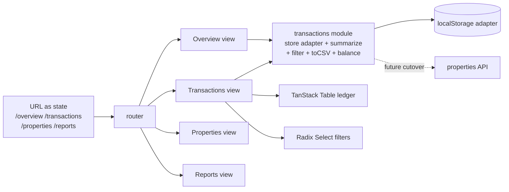

## Context

The web app is one route rendering a four-tab shell held in `useState`; `MainContent.tsx` forwards eight filter props; transaction logic (persistence, filtering, aggregation, CSV, ids) is smeared across eight files with the money reduce duplicated eight times; three inline `formatCurrency` copies disagree on fraction digits; and the ledger renders as a generic admin table. The committed "Bank Passbook" direction (`web/.impeccable/surfaces/src-app-tsx.md`, anchored by `web/.impeccable/mocks/decision/model-pick.html`) fixes the destination; the architecture re-walk (2026-11-21) fixes the order of operations underneath it.

Diagram assumptions (C4-inspired, plain Mermaid, container level): no runtime seam changes; the transactions module is a new deep module inside the web container; the routed shell replaces the single route.

- The transactions module owns every money computation, including the new running balance — one interface, views consume.
- The router becomes the navigation seam it was installed to be; filter state stops prop-drilling through `MainContent`.
- The store adapter is the seam the confirmed server cutover (PRODUCT.md) will one day swap.

## Goals / Non-Goals

**Goals:**

- Land the passbook world on the shell, Overview, and Transactions at full commitment; chrome-only on Properties and Reports.
- Give the ledger its two new behaviors — running balance (displayed-order, client-derived) and column sorting — inside a deep transactions module.
- Retire the raw `<select>` pair (TransactionForm, FilterControls) onto Radix Select.
- Fold C1: one transactions module lands with this change so the rewrite cannot re-scatter the logic.

**Non-Goals:**

- No Rust API changes; no Properties/Reports content treatment; no CI; no spec fencing or harness work (`adopt-acceptance-suite` owns those); no C2/C4 contract or Rust refactorings.

## Decisions

**1. The transactions module lands first, inside this change.** One pure `web/src/transactions/` module (storage adapter with the keys and event names exported once, `addTransaction`/`removeTransaction`, `filterTransactions`, `summarizeTransactions` — totals, month, six-month trend — `runningBalance`, RFC-4180 `toCSV`, name-keyed categories). The hooks become thin adapters. Landing it here guarantees the running balance gets a home instead of becoming a ninth inline reduce, and the server cutover swaps one adapter.

**2. URL becomes state, with a redirect.** Four TanStack file routes; `/` redirects to `/overview` so no existing entry point breaks. `TabType`'s three declarations and the `MainContent` forwarding corridor are deleted. URL-as-state is durable and recorded as ADR-0003 by this change's adr artifact.

**3. TanStack Table for the ledger.** `@tanstack/react-table` (explicit caret per ADR-0001) supplies column structure and sorting; the running balance is a derived column computed by the transactions module in displayed order. TanStack Router is already a dependency — the routes cost no new package.

**4. Radix Select everywhere.** `TransactionForm` and `FilterControls` — the complete set of raw selects — move onto the existing `ui/select.tsx`; the passbook hairline grid styles the triggers and portals.

**5. The deduped formatter is consumed, not re-created.** The C3+C6 change lands first and settles money formatting (two fraction digits everywhere) and the icon map; the rebuilt surfaces import them. This change does not reopen the fraction-digit policy.

**6. Verification is the suite plus the code-led pipeline.** The acceptance suite executes the five kept web-app scenarios and the two added ones; URL addressability gets a manual live smoke across the four routes and the redirect. The impeccable code-led pipeline (craft floor, batched screenshots at 1440×900 and 390×844, the design detector, the independent finish reviewer, DESIGN.md at finish) governs craft; `model-pick.html` rides as the critique reference.

## Risks / Trade-offs

- [Applying out of order re-duplicates the formatter and re-scatters transaction logic] -> Ordering is pinned: adopt-acceptance-suite, then C3+C6, then this change.
- [Radix Select inside the passbook grid] -> Trigger borders and portal layering are called out in the craft pass; the detector checks the result.
- [The suite does not fence URL addressability] -> The live smoke covers the four routes and the redirect; a navigation capability can be spec'd later if it earns one.
- [The balance follows displayed order under sorting] -> Spec'd explicitly in the delta; the module's `runningBalance` takes the rows it is given.

## Migration Plan

1. Transactions module + hooks as adapters (code zone, committed).
2. File routes + redirect; the old shell files deleted (code zone, committed).
3. Passbook tokens and shell styling; Overview and Transactions rebuilt on TanStack Table with Radix Select (code zone, committed).
4. Craft pass (spacing, borders, density), responsive sweep, screenshots at both sizes.
5. Suite green on web-app's seven scenarios; live smoke across routes; detector; finish review; DESIGN.md at finish.

## Open Questions

- None blocking. The product name ("Landlord Ledger" today) stays current-state until a rename decision is made deliberately.
