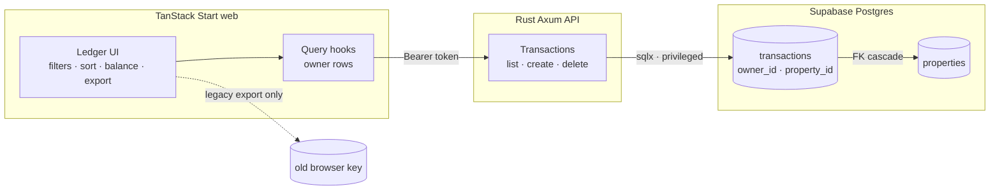

## Context

The ledger is a browser artifact today: one `landlord-transactions` key, a `useSyncExternalStore` adapter, local add/remove/restore, and client-derived filters, sorting, running balance, totals, and CSV. The API already owns properties, and the pending `landlord-accounts` change adds JWKS verification, owner scoping, and a seeded test identity. This change moves the ledger behind the API and retires the local store.

- The API is the only ledger writer; the browser keeps only a one-time legacy reader for export/discard.
- The derived views remain client-side over the complete fetched owner set.
- The property cascade is the database's, not an application loop.

## Goals / Non-Goals

**Goals:** durable, owner-scoped ledger CRUD; reload persistence; a safe one-time legacy export/discard; unchanged ledger views and export; a cascade that removes a property's entries; a suite that seeds through the API.

**Non-Goals:** offline queue/cache; import of the legacy entries; transaction editing; server-side filtering/pagination; changing filter/sort/balance/export display semantics; multi-currency; attachments; sharing; an audit trail; changing the Local-Date Rule.

## Decisions

**1. Data model.** `transactions`:

- `owner_id uuid not null references auth.users(id) on delete cascade`
- `property_id uuid not null references properties(id) on delete cascade`
- `id uuid not null`
- `date date not null`, `description text not null`, `category text not null`, `type text` checked `income|expense`, `amount numeric(12,2)` checked `> 0`, `created_at timestamptz`
- primary key `(owner_id, id)`; indexes on `(owner_id, date)` and `(property_id)`.

The composite key makes an id owner-scoped: a client id cannot collide with another owner's row, and a repeat create for one owner is idempotent. The property FK is the cascade. The owner/property consistency is checked in the API: the property must be the caller's, and the owner is the token's subject.

**2. API.** The owner-scoped endpoints are `GET /transactions` (list the caller's rows, ordered date then id), `POST /transactions` (create; optional `id` for restore; 201 new, 200 existing), and `DELETE /transactions/{id}` (404 for missing or not-owned). The envelope and camelCase rules are the existing ones. Validation: a missing `propertyId` is 400; an unknown or not-owned property is 404; an impossible date, a non-positive or over-precision amount, an empty description/category, or an invalid type is 400; no token is 401. The create accepts the client's UUID only when it is a valid UUID; the server assigns one otherwise. The response carries `id`, `propertyId`, `date`, `description`, `category`, `type`, `amount`, `createdAt`; the owner is never exposed. OpenAPI gains the bearer scheme and the new paths; the hand-maintained client gains the methods.

**3. The web ledger.** The local store is replaced by query hooks: fetch on mount, window focus, and after mutations. The fetched rows map `propertyId` to the existing `property` id; the property name resolves from the fetched properties list. The filters, sorting, running balance, book-authority rail, totals, and export run over the complete fetched owner set; the API order is irrelevant, with a deterministic date-then-id sort on the client. The amount keeps the number-of-pesos wire shape with two decimals; the display, totals, and CSV are unchanged. No pagination: the running balance is only correct over the complete owner set, and a future pagination must preserve that.

**4. The undo.** Delete commits immediately. The client keeps the deleted row's snapshot for five seconds, then drops it. Restore is `POST` with the original id; the owner-scoped key makes it idempotent. A reload or navigation drops the snapshot and the deletion is final. A restore fails with a named error if the property was deleted meanwhile (the cascade removed the row) or the API is unreachable; the snapshot stays available for a retry. Another device does not see the row during the window.

**5. Failure states.** A failed list is the unreachable state with a retry, never empty. A failed create keeps the form populated with an inline error; the same id is reused on retry, so a retry after an ambiguous timeout returns the existing row. A failed delete leaves the row visible with an error. A failed restore keeps the snapshot with an error. A 401 defers to the `landlord-accounts` session behavior (refresh once, then sign out).

**6. The local ledger retirement.** A small `legacyLedger` module remains separate from the API client: it detects a populated `landlord-transactions` key, parses the old row shape, exports the old CSV, and clears the key. The trigger is the ledger's first load, before the server fetch. The notice states the entries are not imported. Export and continue clears the key; continue without exporting requires an explicit destructive confirmation and then clears it. A malformed payload is reported as unreadable and nothing is imported. The rest of the local transactions module (the store, the mutations, the sync adapter) is removed; the export function is replaced by one over the fetched rows.

**7. The property cascade.** Property deletion is a hard delete (the current API behavior; the auth plan does not soft-delete). The FK cascade removes the transactions atomically. The web confirmation names the ledger entries; it does not claim a count. If a soft delete is ever introduced, this rule must be restated and cannot rely on the cascade.

**8. Acceptance.** The ledger scenarios seed and read through the API as the signed-in test identity; the second owner is the isolation fixture; cleanup lists and deletes the probe rows. The legacy-notice scenarios are the only ones that seed the old key, and they clear it. The child run uses the auth plan's session. The suite's Postgres is the Supabase Postgres, so the FKs to `auth.users` and `properties` resolve.

## Risks / Trade-offs

- **Data loss** — unexported browser entries are gone; the notice and the destructive confirmation are the only mitigation.
- **Online-only** — the ledger is unavailable without the API; the form, row, and snapshot failure states keep the user's work visible.
- **Money precision** — the representation stays two-decimal pesos (a JSON number), the same float semantics as the local ledger; the server rejects over-precision input.
- **Ordering** — the auth plan must be amended before it applies; otherwise a contradictory local-ledger requirement lands first.
- **Pagination** — a future change that pages the list can silently break the running balance unless it loads the complete owner set.
- **Second identity** — the isolation scenarios need the auth plan's second seeded owner; if it is absent, this change cannot run them.

## Migration Plan

1. Amend the pending `landlord-accounts` plan to drop its local-ledger requirement and per-account ledger task; apply and archive it first.
2. Add the transactions migration (table, FKs, composite key, indexes, RLS, no grants, Data API closed).
3. Add the API routes, validation, idempotent restore, and OpenAPI/client.
4. Replace the local store with the API client and query hooks; add the legacy reader/notice/discard.
5. Update the ledger UI states and the property confirmation; run the acceptance suite; add the API seeding and the new scenarios.

## Open Questions

- The exact legacy CSV columns and whether the legacy export includes the property names (the old export did); the plan retains the old format.
- Whether the auth plan can be amended in the same pass as this proposal or needs its own revise commit; the tasks assume a revise pass before auth applies.
- Whether the production ledger has real user entries; if so, the discard is a migration decision, not a courtesy.
